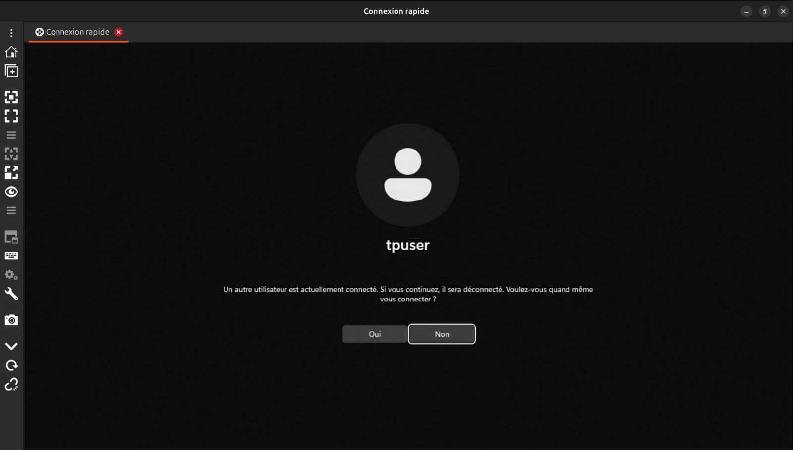
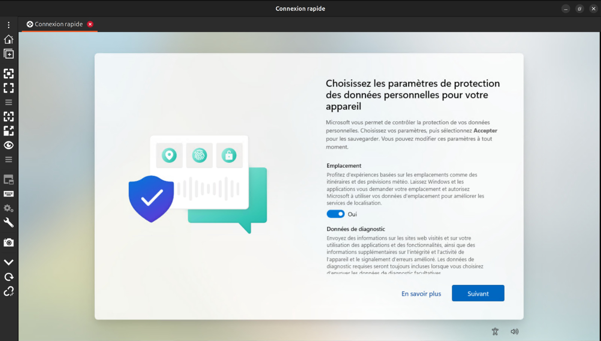
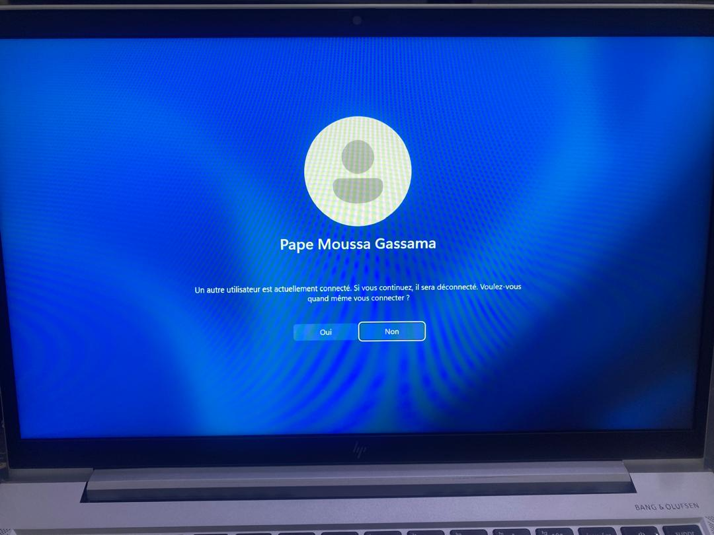
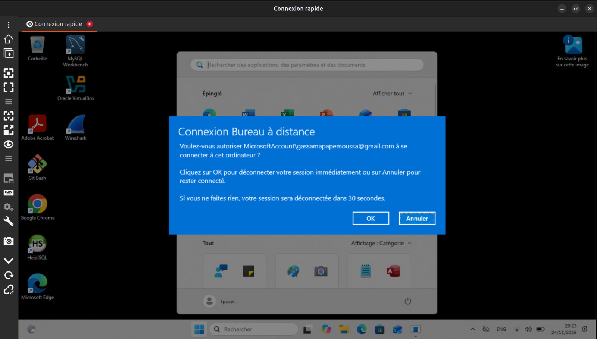
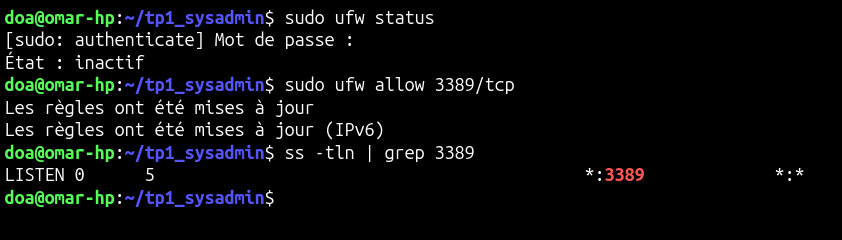
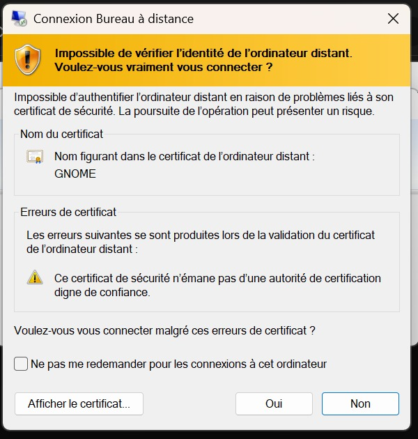

# TP RDP : Configuration et utilisation de Remote Desktop Protocol

**Cours :** Services Réseaux Avancés, L3 GLSI, DGI-ESP 2026-2027
**Enseignant :** Dr. GUEYE
**Binôme :** Pape Moussa Gassama et Omar Aminata Diop
**Date de réalisation :** 24/11/2026

---

## 1. Introduction

Le protocole **RDP (Remote Desktop Protocol)** permet de prendre le contrôle du bureau d'un ordinateur à distance, à travers le réseau, sur le port **TCP 3389**. L'objectif de ce TP est de configurer et d'utiliser RDP pour accéder à une machine distante de manière sécurisée, depuis un client Windows et depuis un client Linux.

Ce document présente, étape par étape, ce que nous avons réalisé, avec les captures d'écran correspondantes.

## 2. Environnement de travail

| Rôle | Machine | Système |
|---|---|---|
| Serveur RDP | PC `Pape_Moussa` | Windows 11 |
| Client RDP | PC `omar-hp` | Ubuntu, avec le client Remmina 1.4.43 |
| Serveur RDP (sens inverse) | PC `omar-hp` | Ubuntu (GNOME), adresse IP 10.7.30.160 |
| Client RDP (sens inverse) | PC `Pape_Moussa` | Windows 11, avec le client `mstsc` |

Nous avons réalisé le TP dans **les deux sens** : d'abord avec Windows comme serveur et Linux comme client (parties 1 à 3), puis avec Linux comme serveur et Windows comme client (partie 4).

---

## 3. Partie 1 : Activation du Bureau à distance sur le serveur Windows

### 3.1 Activation du Bureau à distance

Sur le PC Windows qui joue le rôle de serveur, nous avons ouvert **Paramètres > Système > Bureau à distance** et activé l'option **Bureau à distance**. Le commutateur est bien sur « Activé ». Cette fonction n'est disponible en mode serveur que sur les éditions Pro, Enterprise ou Education de Windows : comme l'option est accessible sur notre machine, son édition est compatible.

Nous avons également relevé le **nom du PC** (`Pape_Moussa`), qui sert d'identifiant pour se connecter depuis un autre appareil, à la place de l'adresse IP.

Nous avons ensuite ouvert la liste des **utilisateurs du Bureau à distance**. Le compte `gassamapapemoussa@gmail.com` y figure déjà et dispose donc d'un accès. Par défaut, les membres du groupe Administrateurs peuvent aussi se connecter, même s'ils ne sont pas listés.


### 3.2 Vérification du pare-feu Windows Defender

Pour que les connexions RDP puissent atteindre la machine, nous avons vérifié que le pare-feu ne les bloque pas. Dans **Autoriser une application à communiquer à travers le Pare-feu Windows Defender**, nous avons contrôlé que les entrées **Bureau à distance** et **Bureau à distance (WebSocket)** sont cochées, aussi bien pour les réseaux **privés** que **publics**.


### 3.3 Création d'un compte de test et autorisation de connexion

Pour tester l'accès distant sans utiliser nos comptes personnels, nous avons créé un compte local `tpuser` depuis PowerShell, ouvert en administrateur :

```powershell
net user tpuser <mot_de_passe> /add
net localgroup "Utilisateurs du Bureau à distance" tpuser /add
```

La commande s'est terminée correctement. Quand `tpuser` s'est connecté depuis l'autre machine, Windows a affiché sur le serveur la fenêtre **« Voulez-vous autoriser Pape_Moussa\tpuser à se connecter à cet ordinateur ? »**. Elle propose deux choix : **OK** déconnecte immédiatement la session en cours, **Annuler** la conserve. Sans réponse, la session est déconnectée au bout de 30 secondes.


---

## 4. Partie 2 : Connexion depuis un client Linux avec Remmina

### 4.1 Installation et lancement de Remmina

Sur la machine Ubuntu qui joue le rôle de client, nous avons installé **Remmina** et son plugin RDP, puis nous l'avons lancé :

```bash
sudo apt update
sudo apt install remmina remmina-plugin-rdp
remmina
```

La capture montre la fin de l'installation (paramétrage de `remmina`, `remmina-plugin-rdp`, `remmina-plugin-vnc` et `remmina-plugin-secret`) et la fenêtre **Visionneur de bureaux distants**, avec le protocole **RDP** sélectionné. La liste de connexions est vide pour l'instant, car aucune connexion n'est encore enregistrée.


### 4.2 Connexion avec le compte `tpuser`

Nous avons saisi l'adresse du serveur Windows et les identifiants de `tpuser`. Une session était déjà ouverte sur le serveur, donc Windows nous a prévenus qu'**un autre utilisateur est connecté et qu'il sera déconnecté si nous continuons**. Nous avons confirmé pour poursuivre la connexion.



Le client a ensuite affiché **« Attendez la réponse de gassamapapemoussa@gmail.com »** : la connexion reste en attente tant que le propriétaire de la session sur le serveur n'a pas répondu à la demande d'autorisation vue plus haut.


Une fois la connexion autorisée, la session de `tpuser` s'est ouverte. Comme c'était la **première connexion** de ce compte, Windows a lancé son assistant de configuration initiale, ici le choix des paramètres de protection des données personnelles (localisation, données de diagnostic).



### 4.3 Bureau distant opérationnel

Après la configuration initiale, nous avons obtenu le **bureau complet du serveur Windows** dans la fenêtre Remmina, avec le menu Démarrer ouvert sous le compte `tpuser`. Nous voyons les applications installées sur le serveur (Edge, Word, Excel, VirtualBox, Wireshark, etc.). La connexion RDP fonctionne donc, et nous pouvons utiliser la machine distante comme si nous étions devant elle.


---

## 5. Partie 3 : Gestion des sessions

Windows n'autorise qu'**une seule session interactive à la fois** sur ce poste. Nous avons donc observé ce qui se passe quand deux utilisateurs veulent se servir de la machine en même temps.

Pendant que `tpuser` était connecté à distance, le propriétaire a voulu rouvrir sa session sur l'écran du PC. Windows l'a averti qu'**un autre utilisateur est actuellement connecté et que celui-ci sera déconnecté s'il continue**, en proposant **Oui** ou **Non**.



De l'autre côté, dans la session distante de `tpuser`, une notification a demandé : **« Voulez-vous autoriser MicrosoftAccount\gassamapapemoussa@gmail.com à se connecter à cet ordinateur ? »**. En cliquant sur **OK**, la session distante est déconnectée immédiatement. En cliquant sur **Annuler**, elle reste ouverte. Sans réponse, elle est déconnectée au bout de 30 secondes.



---

## 6. Partie 4 : Linux en serveur RDP et Windows en client

Pour compléter le TP, nous avons inversé les rôles : la machine Ubuntu est devenue le serveur RDP et le PC Windows le client.

### 6.1 Ouverture du port 3389 sur le serveur Linux

Sur Ubuntu, nous avons d'abord regardé l'état du pare-feu UFW, qui était **inactif**. Nous avons quand même ajouté une règle autorisant le port RDP, puis vérifié que le service écoute bien dessus :

```bash
sudo ufw status
sudo ufw allow 3389/tcp
ss -tln | grep 3389
```

UFW a confirmé la mise à jour des règles en IPv4 et en IPv6. La commande `ss` affiche une ligne **`LISTEN`** sur le port **3389** : le serveur RDP est prêt à recevoir des connexions. La règle reste utile le jour où le pare-feu sera activé.



### 6.2 Connexion depuis le client Windows et avertissement de certificat

Sur le PC Windows, nous avons lancé le client **Connexion Bureau à distance** (`mstsc`) et saisi l'adresse IP du serveur Linux, `10.7.30.160`. Windows a alors affiché un avertissement : **« Impossible de vérifier l'identité de l'ordinateur distant »**. Le certificat présenté par le serveur (nom **GNOME**) n'émane pas d'une autorité de certification de confiance : il est **auto-signé**. Dans le cadre du TP, nous avons accepté de continuer. En production, il faudrait installer un certificat émis par une autorité reconnue, sinon rien ne garantit qu'on se connecte au bon serveur.



### 6.3 Bureau Linux affiché sous Windows

Après avoir accepté le certificat, la session s'est ouverte : la barre de titre indique `10.7.30.160 - Connexion Bureau à distance`, et nous voyons le **bureau Ubuntu** (barre latérale, navigateur) dans la fenêtre du client Windows. La connexion RDP fonctionne donc dans les deux sens.


---

## 7. Observations et points de sécurité

- RDP utilise le port **TCP 3389**. Il ne doit pas être exposé directement sur Internet.
- Le serveur Windows impose une **autorisation explicite** quand une session est déjà ouverte, ce qui évite qu'un utilisateur en déconnecte un autre sans qu'il le sache.
- Le **certificat auto-signé** du serveur Linux déclenche un avertissement. Il faut le remplacer par un certificat de confiance en dehors d'un cadre de test.
- Chaque compte doit avoir un **mot de passe robuste**. Le compte `tpuser` était un compte de test, créé uniquement pour ce TP.
- Pistes pour renforcer la sécurité : authentification au niveau du réseau (**NLA**), restriction des adresses IP autorisées dans le pare-feu, changement du port par défaut, accès via **VPN** ou **tunnel SSH**.

## 8. Conclusion

Ce TP nous a permis de configurer un serveur RDP sous Windows et sous Linux, de nous y connecter depuis un client Linux (Remmina) et depuis un client Windows (`mstsc`), et de comprendre la gestion des sessions ainsi que les points de sécurité à surveiller : pare-feu, certificats, comptes et exposition du port 3389.
