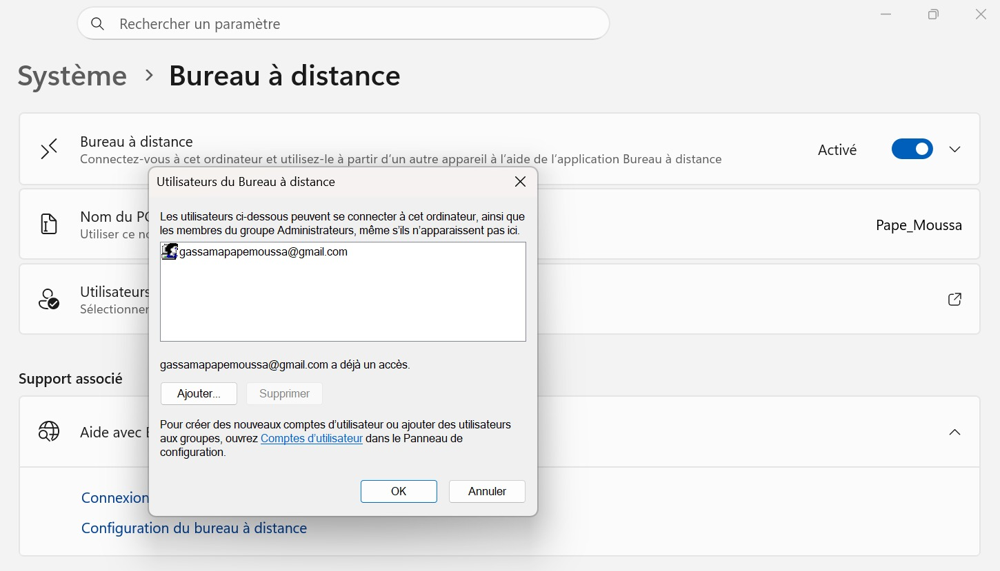
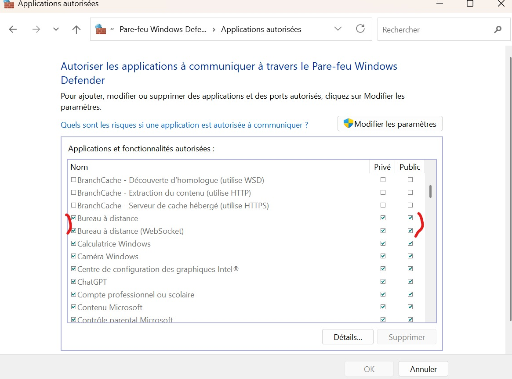
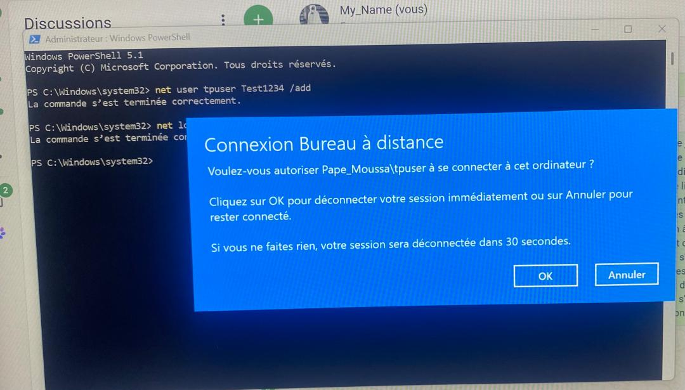
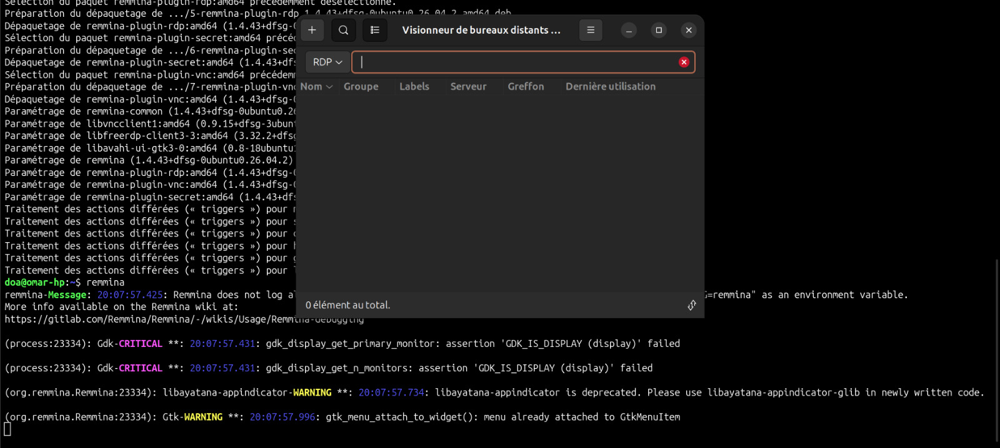
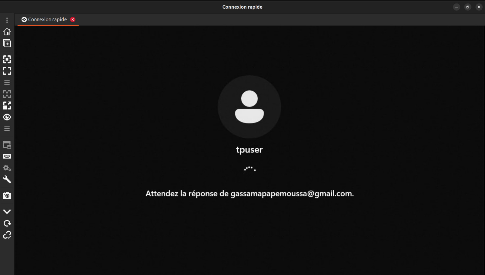
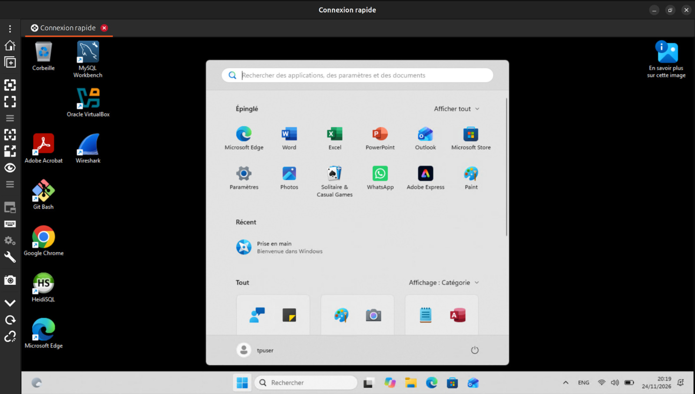
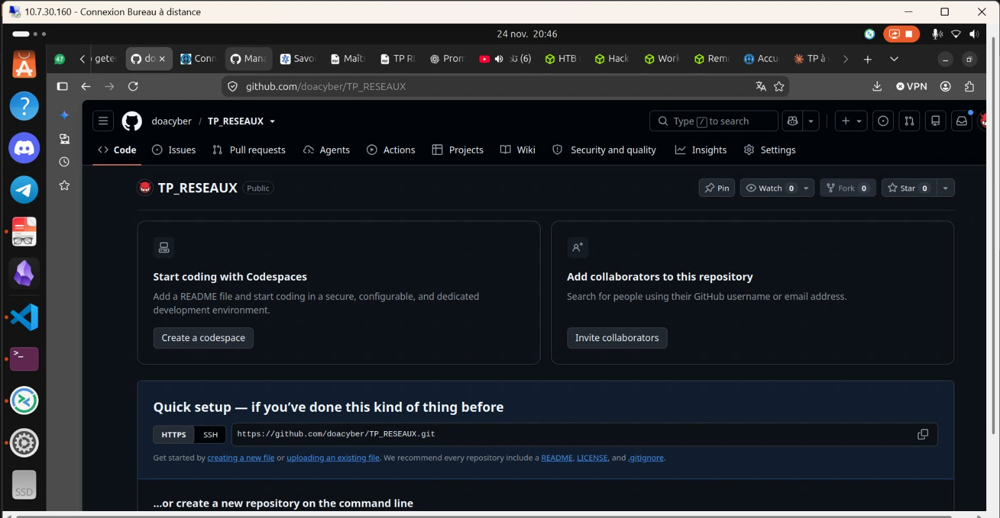

# TP RDP : Configuration et utilisation de Remote Desktop Protocol

**Cours :** Services Réseaux Avancés, L3 GLSI, DGI-ESP 2026-2027
**Enseignant :** Dr. GUEYE
**Binôme :** Pape Moussa Gassama et Omar Aminata Diop
**Date de réalisation :** 24/11/2026

## Objectif

Configurer et utiliser RDP (port TCP 3389) pour accéder à distance à un ordinateur de manière sécurisée, avec un client Windows et un client Linux.

## Environnement

| Rôle | Machine | Système |
|---|---|---|
| Serveur RDP | PC `Pape_Moussa` | Windows 11 |
| Client RDP | PC `omar-hp` | Ubuntu, client Remmina 1.4.43 |
| Serveur RDP (sens inverse) | PC `omar-hp` | Ubuntu (GNOME), IP 10.7.30.160 |
| Client RDP (sens inverse) | PC `Pape_Moussa` | Windows 11, `mstsc` |

Le TP a été réalisé dans les deux sens : Windows en serveur avec Linux en client, puis Linux en serveur avec Windows en client.

---

## Partie 1 : Activer le Bureau à distance sur le serveur Windows

### 1.1 Activation et utilisateurs autorisés

Dans **Paramètres > Système > Bureau à distance**, l'option est activée. Le nom du PC (`Pape_Moussa`) sert à la connexion. Le compte `gassamapapemoussa@gmail.com` a déjà accès, comme les membres du groupe Administrateurs.



### 1.2 Pare-feu Windows Defender

Dans les applications autorisées à communiquer à travers le pare-feu, **Bureau à distance** et **Bureau à distance (WebSocket)** sont cochés pour les réseaux privé et public.



### 1.3 Création d'un compte de test

Un compte local `tpuser` est créé en PowerShell (administrateur) pour tester la connexion distante :

```powershell
net user tpuser <mot_de_passe> /add
net localgroup "Utilisateurs du Bureau à distance" tpuser /add
```

Lorsque `tpuser` se connecte, Windows demande au propriétaire de la session de l'autoriser.



---

## Partie 2 : Connexion depuis un client Linux (Remmina)

### 2.1 Installation de Remmina

```bash
sudo apt update
sudo apt install remmina remmina-plugin-rdp
remmina
```



### 2.2 Connexion avec `tpuser`

Une session est déjà ouverte sur le serveur, donc Windows prévient qu'elle sera déconnectée si on continue.


Le client attend ensuite la réponse du propriétaire de la session.



Après l'autorisation, la session s'ouvre. C'est la première ouverture de `tpuser`, donc Windows affiche l'écran de configuration initiale.


### 2.3 Bureau distant

On a accès au bureau du serveur Windows comme si on y était physiquement.



---

## Partie 3 : Gestion des sessions

Windows n'autorise qu'une seule session interactive à la fois sur ce poste. Quand le propriétaire essaie de se reconnecter physiquement, il est averti que la session de `tpuser` sera déconnectée.


Dans la session distante de `tpuser`, une notification demande s'il faut autoriser le propriétaire. **OK** déconnecte la session distante, **Annuler** la conserve.


---

## Partie 4 : Linux en serveur RDP et Windows en client

### 4.1 Ouverture du port 3389 sur le serveur Linux

```bash
sudo ufw status
sudo ufw allow 3389/tcp
ss -tln | grep 3389
```

Le pare-feu UFW était inactif. La règle est ajoutée et le port 3389 est bien en écoute (`LISTEN`).


### 4.2 Connexion depuis le client Windows

On lance `mstsc` et on saisit l'adresse IP du serveur Linux. Le certificat du serveur (`GNOME`) est auto-signé, donc Windows affiche un avertissement. On peut continuer dans un cadre de TP, mais ce n'est pas recommandé en production.


### 4.3 Bureau Linux affiché sous Windows



---

## Observations et sécurité

- RDP utilise le port **TCP 3389**. Il ne doit pas être exposé directement sur Internet.
- Le certificat auto-signé déclenche un avertissement. Il vaut mieux utiliser un certificat émis par une autorité de confiance.
- Chaque utilisateur doit avoir un mot de passe robuste. Le compte `tpuser` était un compte de test.
- Pistes pour renforcer la sécurité : authentification au niveau du réseau (NLA), limitation des adresses IP autorisées dans le pare-feu, changement du port par défaut, accès via VPN ou tunnel SSH.

## Conclusion

Le TP nous a permis de configurer un serveur RDP sous Windows et sous Linux, de nous y connecter depuis Remmina et depuis le client Bureau à distance de Windows, et de comprendre la gestion des sessions et les points de sécurité à surveiller.
